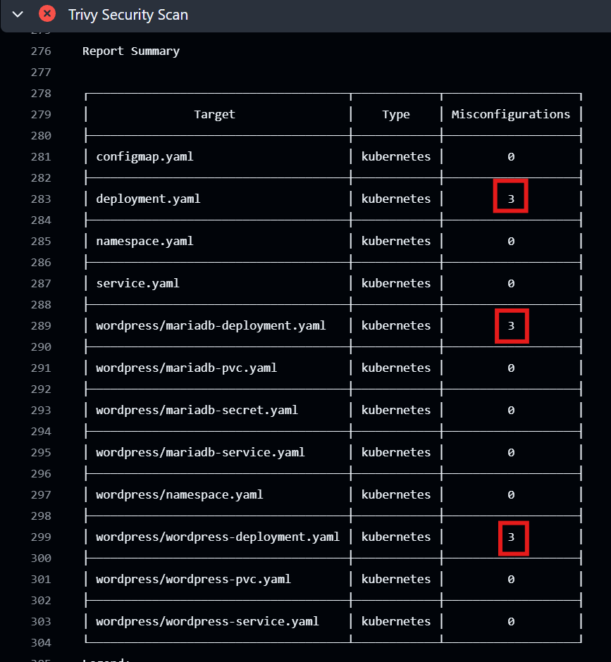
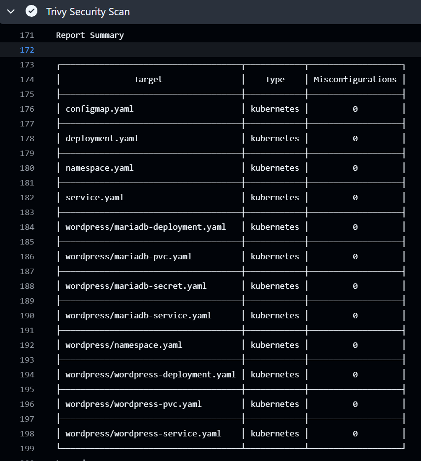
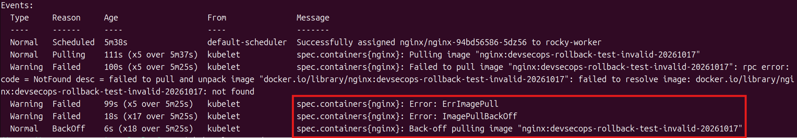
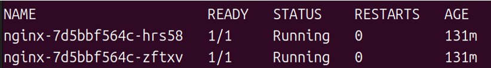
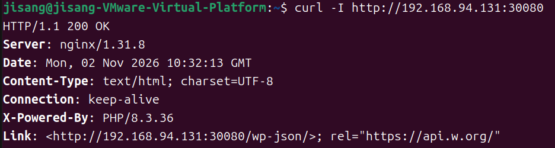
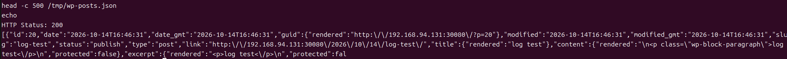

# Kubernetes GitOps & DevSecOps CI

Kubernetes Manifest를 Git으로 관리하고, Pull Request 단계에서 스키마 및 보안 설정을 검사한 뒤 Argo CD를 통해 배포하는 실습 프로젝트입니다. 보안 설정 개선과 이미지 태그 오류에 대한 장애 재현·원복 과정을 기록했습니다.

## 1. 프로젝트 구성과 범위

| 구성 | 역할 |
|---|---|
| Kubernetes (kubeadm) | NGINX·WordPress·MariaDB 실습 환경 |
| GitHub Actions | Pull Request 대상 CI 실행 |
| Kubeconform | Kubernetes Manifest 스키마 검증 |
| Trivy | Manifest 보안 설정 검사 |
| Argo CD | Git 변경 사항을 Kubernetes로 동기화 |
| Longhorn PVC | WordPress·MariaDB 데이터 저장 |

이 저장소에는 주로 **Kubernetes Manifest와 CI 설정**이 포함되어 있습니다. kubeadm 설치, Argo CD Application, Longhorn StorageClass 등 클러스터 전체 구성 파일은 이 저장소에 포함되어 있지 않습니다.

## 2. CI/CD 흐름

```text
Manifest 수정 → Pull Request (main)
                    ↓
             GitHub Actions
              ├─ Kubeconform (스키마 검사)
              └─ Trivy (HIGH/CRITICAL 설정 검사)
                    ↓
             검사 결과 확인 후 Merge
                    ↓
            Argo CD 동기화
                    ↓
              Kubernetes 적용
```

- [GitHub Actions 워크플로](.github/workflows/kubernetes-ci.yml)
- PR 대상 브랜치는 `main`이며, `workflow_dispatch` 수동 실행도 지원합니다.
- Kubeconform은 `-strict -summary -kubernetes-version 1.36.0` 옵션으로 실행되도록 설정했습니다.
- Trivy는 `scan-type: config`, `severity: HIGH,CRITICAL`, `exit-code: '1'`로 설정했습니다.
- CI 실패 자체가 Merge를 차단하려면 **브랜치 보호/필수 상태 검사**가 별도로 필요합니다.
- Argo CD 자동 동기화 여부는 클러스터에 구성한 Application 설정에 따릅니다.

## 3. 저장소 구조

```text
argocd-test/
├── .github/workflows/kubernetes-ci.yml
├── .gitignore
├── docs/
│   ├── example/mariadb-secret.example.yaml
│   └── images/
│       ├── trivy-before.png
│       ├── trivy-after.png
│       ├── imagepullbackoff.png
│       └── nginx-running.png
├── wordpress/
│   ├── mariadb-deployment.yaml
│   ├── mariadb-pvc.yaml
│   ├── mariadb-service.yaml
│   ├── namespace.yaml
│   ├── wordpress-deployment.yaml
│   ├── wordpress-pvc.yaml
│   └── wordpress-service.yaml
├── configmap.yaml
├── deployment.yaml
├── namespace.yaml
└── service.yaml
```

- NGINX는 `service.yaml`에서 NodePort `30080`을 사용하며, `configmap.yaml`에서 WordPress Service를 향해 Reverse Proxy를 구성합니다.
- WordPress와 MariaDB는 `wordpress` 네임스페이스를 사용하고 각각 Longhorn PVC를 참조합니다.

## 4. Trivy 보안 설정 검사와 개선

2026년 10월 17일 검사에서 Kubernetes 설정 파일 12개를 대상으로 `trivy config .` 검사를 수행한 결과, 세 Deployment 파일에서 9건의 Misconfiguration이 탐지되었습니다. 이후 관련 보안 설정을 수정한 뒤 재검사하여 0건을 확인했습니다.

| 검사 대상 | 수정 전 | 수정 후 | 코드 변경 |
|---|---:|---:|---|
| `deployment.yaml` | 3건 | 0건 | [NGINX 커밋](https://github.com/cojisang/argocd-test/commit/f7dc2f2) |
| `wordpress/mariadb-deployment.yaml` | 3건 | 0건 | [MariaDB 커밋](https://github.com/cojisang/argocd-test/commit/ec7d403) |
| `wordpress/wordpress-deployment.yaml` | 3건 | 0건 | [WordPress 커밋](https://github.com/cojisang/argocd-test/commit/415ad68) |
| **합계** | **9건** | **0건** | |

적용한 주요 설정은 `seccompProfile: RuntimeDefault`, `allowPrivilegeEscalation: false`, `readOnlyRootFilesystem: true`입니다.

읽기 전용 루트 파일시스템 적용 시 필요한 쓰기 경로는 별도 `emptyDir` 볼륨에 연결했습니다. MariaDB의 `/var/lib/mysql` 데이터 저장 경로는 PVC를 유지했습니다.

MariaDB·WordPress의 `Recreate`는 보안 조치와 별개의 배포 전략입니다.

### 수정 전 — Trivy 검사 실패 (9건)

[GitHub Actions 실패 실행 기록](https://github.com/cojisang/argocd-test/actions/runs/39029021458/job/117385575201)



### 수정 후 — Trivy 검사 성공 (0건)

[GitHub Actions 성공 실행 기록](https://github.com/cojisang/argocd-test/actions/runs/39034712811/job/117402111548)



> 0건은 당시 Trivy Configuration Scan에서 탐지한 설정 문제에 대한 결과이며, 모든 이미지·런타임 보안 위험이 제거되었다는 의미는 아닙니다.

## 5. ImagePullBackOff 장애 재현과 Git Revert

Manifest 구조 및 보안 검사를 통과해도 실제 레지스트리에 이미지 태그가 없으면 배포에 실패할 수 있다는 점을 확인하기 위한 테스트입니다.

### 1. 장애 재현 — PR #5

[PR #5 변경 내역](https://github.com/cojisang/argocd-test/pull/5/files)

NGINX Deployment의 이미지 태그를 존재하지 않는 테스트용 태그로 변경했습니다.

**변경 전**

`nginx:latest`

**변경 후**

`nginx:devsecops-rollback-test-invalid-20261017`

### 2. ImagePullBackOff 발생 및 원인 확인

Pod 이벤트에서 이미지 다운로드 실패를 확인했습니다.

- `Failed to pull image`
- `not found`
- `ErrImagePull`
- `ImagePullBackOff`

Deployment에 설정한 이미지 태그가 레지스트리에 존재하지 않는 것이 원인이었습니다.

**실제 장애 발생 이벤트**



### 3. Git Revert를 통한 설정 복구 — PR #6

[PR #6 변경 내역](https://github.com/cojisang/argocd-test/pull/6/files)

Git Revert를 통해 잘못된 이미지 태그를 기존 태그로 되돌렸습니다.

**변경 전**

`nginx:devsecops-rollback-test-invalid-20261017`

**복구 후**

`nginx:latest`

기존 Deployment의 보안 설정은 유지하면서 이미지 태그 변경만 원복했습니다.

### 4. Pod 상태 확인

별도로 확보한 Pod 상태 화면에서 NGINX Pod 두 개가 `1/1 Running`, 재시작 0회로 표시된 것을 확인했습니다.

**NGINX Pod Running 확인 화면**



### 5. 검증 결과

| 검증 항목 | 결과 |
|---|---|
| 잘못된 이미지 태그 적용 | PR #5에서 확인 |
| 이미지 다운로드 실패 | `ErrImagePull` 확인 |
| ImagePullBackOff 발생 | Pod 이벤트에서 확인 |
| Git Revert | PR #6에서 확인 |
| 이미지 태그 원복 | `nginx:latest` 복원 |
| 정상 상태 Pod | Running 2개 확인 |

> Git 변경 내역과 Pod 상태 캡처는 보유하고 있으나, 정상 Pod 화면만으로는 Argo CD 동기화 시점이나 HTTP 요청 성공까지 독립적으로 증명할 수는 없습니다.

## 6. Secret 관리 및 재구성 시 주의사항

초기 실습에서는 인증정보가 들어 있는 Secret Manifest를 사용했으나, 현재 저장소에서 해당 파일을 제거했습니다.

공개 저장소에는 실제 인증정보 대신 [MariaDB Secret 예제](docs/example/mariadb-secret.example.yaml)만 남겨두었습니다. 예제의 자리 표시자 값은 실제 배포에 사용하지 마세요.

현재 MariaDB와 WordPress Deployment는 `mariadb-secret`을 참조합니다.

**새 클러스터에서 재구성할 경우**, `wordpress` 네임스페이스에 필요한 실제 Secret을 Git 저장소 밖에서 별도로 생성한 뒤 배포해야 합니다.

Longhorn StorageClass `longhorn-single`과 `rocky-worker` 노드 이름도 실습 환경에 맞게 준비하거나 수정해야 합니다.

`.gitignore`는 앞으로 로컬 Secret 파일이 실수로 추가되는 것을 줄이지만, **과거 커밋의 인증정보를 삭제하지는 않습니다.**

초기 실습용 값은 사용을 종료했으며 재사용하지 않는 전제에서 기록을 보존하고 있습니다.
## Argo CD 및 서비스 정상 동작 검증

### 1. Argo CD 동기화 확인

| Application | Sync Status | Health Status |
|---|---|---|
| nginx | Synced | Healthy |
| wordpress-stack | Synced | Healthy |

### 2. Kubernetes 리소스 확인

- Control Plane / Worker Node: Ready
- NGINX Pod 2개: Running / Ready
- WordPress 및 MariaDB Pod: Running / Ready
- Kubernetes Service 및 NodePort 30080 확인

### 3. HTTP 응답 검증

NGINX NodePort를 통해 WordPress의 HTTP 응답을
확인했습니다.

```bash
curl -I http://192.168.94.131:30080
```

**검증 결과: HTTP/1.1 200 OK**



### 4. WordPress REST API 검증

WordPress REST API를 호출하여 실제 게시글이
정상적으로 조회되는지 확인했습니다.

```bash
curl -sS -o /tmp/wp-posts.json \
  -w 'HTTP Status: %{http_code}\n' \
  'http://192.168.94.131:30080/wp-json/wp/v2/posts?per_page=1'
```

**검증 결과**

- HTTP Status: 200
- JSON 형식의 게시글 데이터 반환
- 게시글 ID: 20
- 게시글 제목: log test
- 게시글 상태: publish



### 5. 검증 결과 정리

Argo CD의 Synced/Healthy 상태와 Kubernetes Pod의
Running 상태를 확인했습니다.

이후 NGINX NodePort를 통한 HTTP 요청과
WordPress REST API 게시글 조회까지 성공하여
현재 배포된 서비스의 정상 동작을 확인했습니다.

이 검증은 현재 클러스터의 동작 확인이며,
과거 Git Revert 직후의 동기화 시점을
증명하는 자료와는 구분됩니다.
